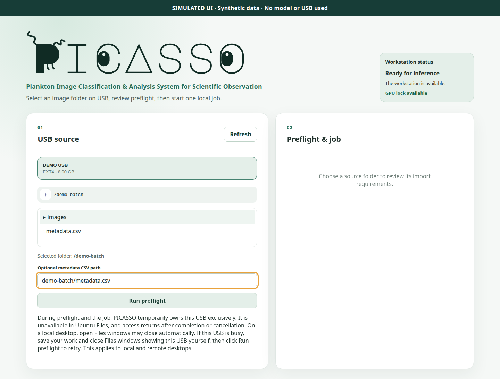
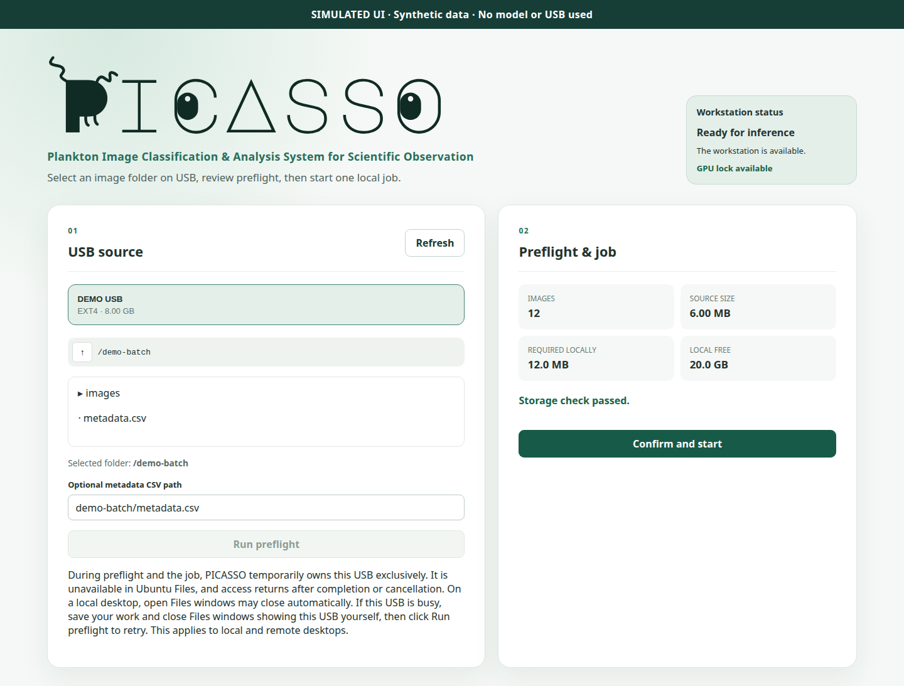
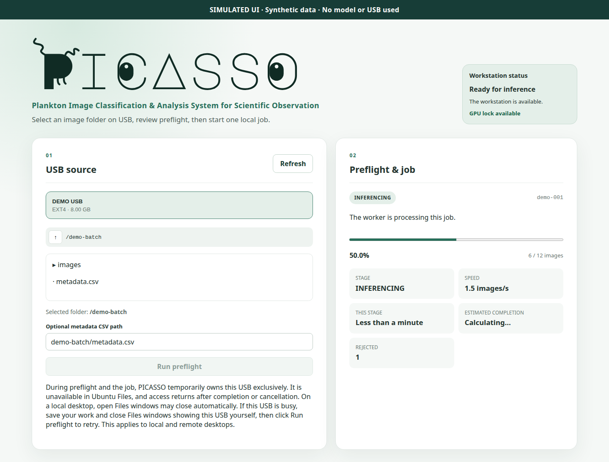
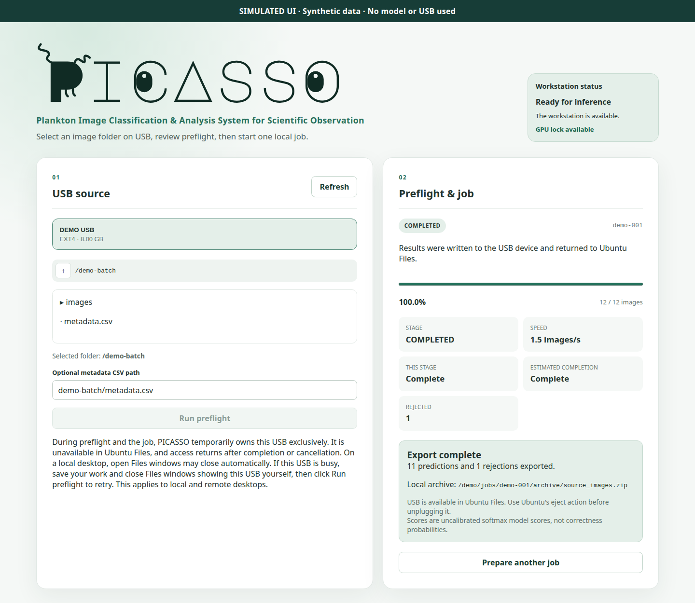

# PICASSO


**Turn a folder of plankton images into traceable classification results.**

*Plankton Image Classification & Analysis System for Scientific Observation*

PICASSO is a side project for researchers processing image batches on a local Ubuntu workstation. It brings USB intake, GPU classification, progress tracking, result export, and input archiving into one workflow.

> **Source-only beta showcase.** Explore the implementation, run the CPU-only tests, and inspect the interface. Real inference requires a separately trusted model and reviewed host deployment; this checkout is not a hosted demo or a complete installation package.

## The problem

A research image batch needs a reliable path from source files to usable results: preserve each image's identity, join optional metadata, record unreadable images, save progress across interruptions, and verify the exported files. Removable media and a GPU shared with training add device-ownership and resource-coordination problems.

PICASSO implements these steps around the classifier, with explicit job states and traceable CSV/JSON outputs.

## See the workflow

**[Watch the v1 beta demo on Google Drive](https://drive.google.com/file/d/1i3bz5awIcIcf7QZb3rSTd7moFuEhFYoC/preview)** — about 5 minutes, recorded in September 2026. This owner-approved historical recording shows the interface, desktop handoff and exported files. It predates the current source snapshot and is not validation of this checkout or a model benchmark.

The screenshots below use the **current public frontend with synthetic API responses**. No research images, model weights or real device data were used. All names, paths, counts, speed and storage values are illustrative; the simulated completion screen does not prove an actual export. Open a screenshot to view the full-size image, then zoom in to inspect the controls.

### 1. Select a source

Choose an image folder, optionally supply a metadata CSV path, then select **Run preflight**.

[](https://raw.githubusercontent.com/mm1719/PICASSO/main/docs/screenshots/01-select-source.png)

### 2. Review preflight

Check the image count and local storage requirement, then select **Confirm and start**.

[](https://raw.githubusercontent.com/mm1719/PICASSO/main/docs/screenshots/02-review-preflight.png)

### 3. Follow the job

Track the current stage, processed images and rejected inputs. An unknown overall ETA remains `Calculating…`.

[](https://raw.githubusercontent.com/mm1719/PICASSO/main/docs/screenshots/03-follow-progress.png)

### 4. Review completion

Review the export summary, local archive location and reminder that scores are uncalibrated. Select **Prepare another job** to return to batch selection.

[](https://raw.githubusercontent.com/mm1719/PICASSO/main/docs/screenshots/04-review-results.png)

The capture uses the real interface, with only a demo label added above it. [Capture source, reproduction steps and scope](docs/screenshots/README.md) explain how these images were made. The historical video and synthetic screenshots are separate demonstrations.

## What it does

1. **Select a batch.** Browse a USB image folder recursively and optionally select a metadata CSV. Supported image candidates are PNG/JPEG; individual decoding failures are recorded.
2. **Check and import.** Run preflight, claim exclusive access to the device, scan the selected tree, and verify copies into local staging before inference.
3. **Classify and follow progress.** Wait for the shared GPU lock, run the configured classifier, and display stage-specific counts, throughput, and estimated time. Unknown estimates remain `Calculating…`.
4. **Produce traceable results.** Preserve image IDs and source-relative paths, report the top prediction, include top-three scores for low-score cases, and summarize rejected images and category counts.
5. **Archive and hand back.** Verify the local input archive and result export to the original device, then return ordinary completed/failed jobs' device ownership to the desktop. Security-blocked jobs follow a separate eject path.

The published source implements this workflow. Hardware and deployment qualification remain limited as described below.

### Result files

| File | Contents |
| --- | --- |
| `predictions_top1.csv` | Top prediction and score for each successfully classified image |
| `low_confidence_top3.csv` | Top three predictions when the top score is below 0.4 |
| `rejected_images.csv` | Rejected image identifiers, processing stage, and reason |
| `counts_summary.csv` | Batch totals and counts for all 20 mapped categories |
| `job_summary.json` | Machine-readable job summary and provenance |

Scores are **uncalibrated softmax scores**, not probabilities of correctness. The 20 categories include broad groups and non-taxonomic targets; they are not 20 species. The fixed mapping retains index 15, `370437 / Heterokontophyta`.

## Engineering highlights

| Design choice | What it addresses |
| --- | --- |
| **Durable job state in SQLite** | Persisted stages and batched prediction commits support resuming interrupted work without treating partial output as complete. |
| **Verified, atomic file publication** | Checksums, temporary outputs, and archive verification protect the boundary between work in progress and published results. |
| **Explicit USB ownership** | A restricted service and fixed-operation broker control exclusive access. Cleanup responsibility survives lost replies, and rollback rechecks device identity. |
| **GPU coordination** | The worker acquires a shared advisory lock before loading the model, coordinating with cooperating training processes. |
| **Separated application and host privileges** | Non-root, read-only application containers do not receive raw USB block devices. Privileged mount operations stay in the host broker. |
| **Recovery tested across layers** | Fake host adapters, in-process API tests, and mocked UI tests exercise failure paths, including cleanup retries and launcher rollback. |

The stack combines **React, TypeScript and Vite** for the interface, **FastAPI** for local control, **SQLite** for persistence, and **PyTorch/timm** for the inference adapter. Docker Compose, systemd and Polkit source illustrate the deployment boundary.

```text
Browser UI (React / TypeScript)
        | loopback HTTP
Control API (FastAPI) ---- SQLite job state
        |                       |
        |                Job worker ---- GPU lock ---- Inference adapter
        |                       |                         (PyTorch / timm)
        +---- Unix socket ------+
                   |
          Restricted USB service
                   | fixed operations
          Privileged mount broker
                   |
              Removable media
```

See [architecture and scientific contracts](docs/ARCHITECTURE.md) and [security boundaries](docs/SECURITY.md) for the implementation details and tradeoffs.

## Validation and current limits

The latest recorded source validation, **2026-11-15**, covers the curated public checkout:

| Check | Recorded result |
| --- | --- |
| Portable Python tests | **373 passed** across 25 modules, using synthetic data and fake host/USB adapters |
| Frontend unit tests | **49 passed** across 4 files, with mocked API interactions |
| Frontend lint, TypeScript and Vite build | **Passed** |
| Synthetic screenshot walkthrough | **1 Playwright test passed**, capturing the four states above with all API calls mocked |

These are source-level and mocked-browser checks. No model-quality benchmark, real inference, GPU, physical USB, live API integration, browser-to-backend end-to-end, host reboot, or deployment validation was performed for this public snapshot. Fresh Python dependency installation, full coverage, mutation testing, dependency-vulnerability and penetration audits were also not performed. There is no production-readiness or project-wide 100% coverage claim.

The supported design scope is **one local machine, one user, and one active inference job**. It has no authentication or multi-tenant isolation and must not be exposed as a public-network service. Workstation assumptions remain in the reference source. Broker recovery has regression coverage, but installed hardware recovery and exFAT/kernel-stall resolution remain unqualified.

The [validation record](docs/VALIDATION.md) gives exact environments, adaptations and exclusions. The [source sync record](docs/SOURCE_SYNC.md) tracks the reviewed development revision and changes included in this showcase.

## Explore without a model or USB

### Run the CPU-only tests

Use Linux and a separate Python 3.11 environment; the tests exercise POSIX pipes and locks:

```bash
python3.11 -m venv .venv-showcase
. .venv-showcase/bin/activate
python -m pip install -r requirements/showcase-dev.txt
make test-portable PYTHON=python
```

Tests use temporary files, synthetic scores, fake host/USB/GTK adapters, and an in-process API client. They do not open real windows, start a live API server, load a model, require service accounts, or modify attached media. After dependencies are installed, the test run is offline.

### Build and inspect the interface

Use a Node.js release compatible with the locked frontend dependencies:

```bash
npm --prefix apps/web ci --ignore-scripts
npm --prefix apps/web run lint
npm --prefix apps/web run test:unit
npm --prefix apps/web run build
npm --prefix apps/web run dev
```

Open the loopback address printed by Vite. The showcase has **no default API proxy**: API-dependent controls show connection errors without an explicitly configured isolated backend. This lets you inspect the interface; it is not a simulated inference demo. Frontend tests exercise mocked interactions separately. Do not connect the preview to an existing research service.

### Real inference requires a separate deployment

The adapter constructs `convnextv2_large.fcmae_ft_in22k_in1k` with `pretrained=False`; it does not download weights. Real use requires an authorized, trusted compatible checkpoint and independently trusted SHA-256, the fixed mapping and preprocessing contract, CUDA-compatible dependencies, storage configuration, and reviewed host integration.

`PLANKTON_CHECKPOINT_PATH` and `PLANKTON_CHECKPOINT_SHA256` are deployment inputs, never job or uploaded-file inputs. The checkpoint loader uses Python pickle semantics; a matching checksum alone does not establish safety. Never load a USB/user-uploaded checkpoint.

`host/`, Dockerfiles, Compose files and environment examples are **deployment reference source**. They include privileged account, mount, service and policy operations; do not install or execute them as part of this quickstart. See the [deployment boundary](docs/DEPLOYMENT_BOUNDARY.md) before planning a dedicated installation.

## Find your way around

| Path | Start here for |
| --- | --- |
| `apps/web/` | Interface and mocked UI tests |
| `apps/api/`, `apps/worker/` | Local control and durable job execution |
| `packages/core/` | Classification, state and output contracts |
| `packages/control/`, `host/` | USB client, ownership and privilege boundaries |
| `packages/inference/` | Trusted-checkpoint inference adapter |
| `packages/simulator/` | Development-only fake adapters |
| `tests/`, `testing/usb_ownership_contract.py` | Portable regressions and the pure ownership evidence evaluator |

## Publication and licensing

The repository excludes research images, datasets, trained weights, private deployment configuration and original development history. It does not provide full experiment reproduction. The owner approved publication of the original SVG logo and the external historical demo link; the new screenshots use synthetic data. Publication of these presentation materials does not grant a separate reuse license.

**No open-source license has been assigned.** Public visibility does not grant an additional code-reuse license; a future license requires a separate rights-holder decision. Dependencies retain their own terms. The [third-party inventory](THIRD_PARTY.md) records available metadata without granting rights to code, datasets, weights or artwork.
